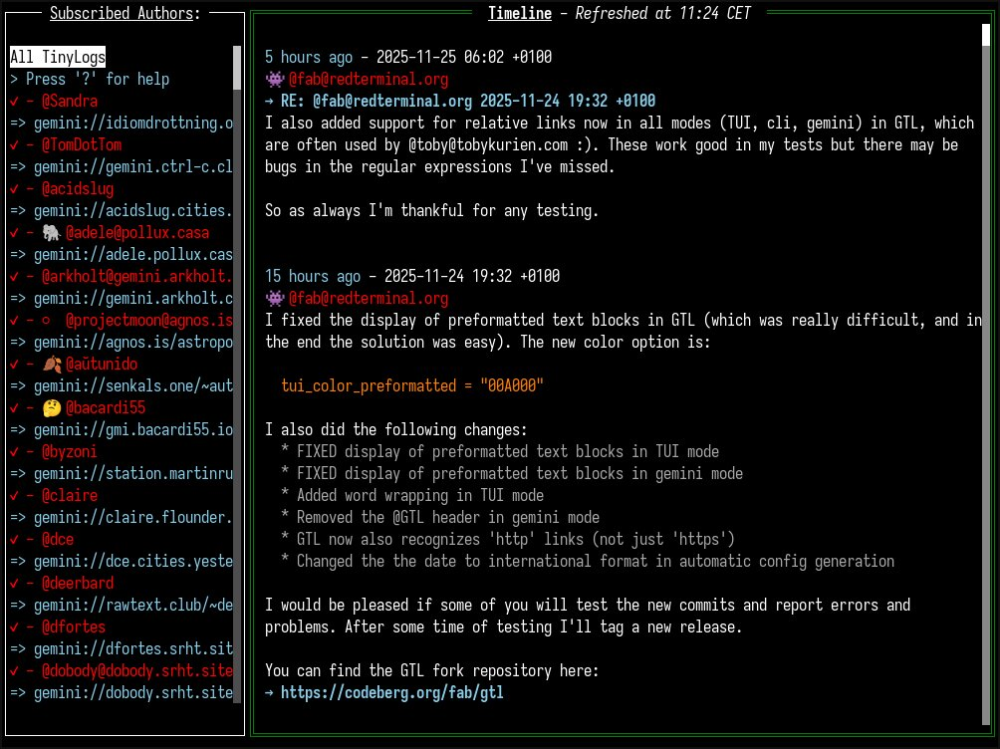

# GTL: Gemini Tiny Logs

GTL is a TUI to view and edit your [Gemini Tinylogs](https://codeberg.org/bacardi55/gemini-tinylog-rfc/src/branch/main). It can also be used as a CGI aggregator for Tinylogs on [Gemini Capsules](https://geminiprotocol.net/) in "gemini" mode. There is also a "cli" command line mode, which puts out the entries with a little formatting.

## Screenshot of GTL Tui Mode


## Quick start:

*Assuming you downloaded the right binary for your system and put it in your binary, eg: ~/bin*:
```
# will create the configuration and subscription files in ~/.config/gtl/.
# You still have to populate your subscription file with tinylog URLs
~/bin/gtl
```

To read the global help:
```
gtl --help
```

## Installation

Please read the [installation page](docs/install.md).

### Experimental OSC52 support (since tag v1.4.0-fork)
GTL now has **experimental** OSC52 support to copy/paste when running GTL over
an SSH connection. But be aware that still not all terminal emulators support
OSC52, for example GNOME and XFCE terminal (VTE-based), konsole (kde), termux
and others. Because I didn't find a recent list with supported/unsupported
terminals, you could ask ChatGPT for a list of supported and unsupported
terminal emulators.

If it's not possible for you to use a terminal which supports OSC52 you could
try to turn on X11Forwarding in your remote machine's sshd config and then run
`ssh -X gtluser@domain.tld` to enable copy/paste in your remote GTL. This
**might** also work.

### Bookmarks (since tag v1.1.2-fork)
If you're updating from an older release, you have to delete your
`bookmarks.json` file and let the gtl binary create a new one, because the 
previous ones have created an invalid JSON file and therefore GTL will disable
bookmark functionality if using the old file.

## Configuration

Please read the [configuration page](docs/config.md)

## Usage

Gtl can run in 3 modes:
* TUI: An interactive TUI. See the [TUI mode documentation](docs/mode-tui.md).
* CLI: A command line interface. See the [CLI mode documentation](docs/mode-cli.md).
* Gemini: A mode that return a text/gemini output, compatible with the Tinylog format. See the [Gemini mode documentation](docs/mode-gemini.md).

## Troubleshooting
If your GTL TUI is very slow and sluggish, you might have an outdated gtl.toml
configuration file. In that case you have to change the `tui_max_entries` entry
to 100 (which might be 0 before).

## Tinylog Subscription List
I also inherited the 'official' Tinylog subscription list, which you can download
at the URL below for an up-to-date Tinylog subscription list. If your Tinylog is still
not on the list or you just started a new Tinylog, send the URL to your Tinylog at
your Gemini Capsule to my email address [-fab- <fab@redterminal.org>](mailto:fab@redterminal.org).

['Official' Tinylog Subscription List](https://redterminal.org/tinylog-subscriptions.gmi)

## This is a Fork of the GTL Gemini Tiny Log viewer by bacardi55
It seems bacardi55 has abandoned the project, so I put up this fork and I
already included the pending patches which came in on his development mailing
list. These are over 7 month old and therefore I think bacardi55 doesn't work
on his project anymore.

I try to work on GTL on a regular basis and hold it up-to-date and also fix
bugs. You can also send in Pull Requests and I'll include them in this
repository. You can also send in patches via `git send-email` if proper
formatted to `fab@redterminal.org`, if you don't have or want a Codeberg.org
account. I'll commit the sent in patches to this repository as soon as possible.

### Official Repository

@bacardi55's original repository and project is still on [sourcehut](https://git.sr.ht/~bacardi55/gtl),
but it's completely outdated. I hope @bacardi55 won't be angry on me, that I
forked his project.

