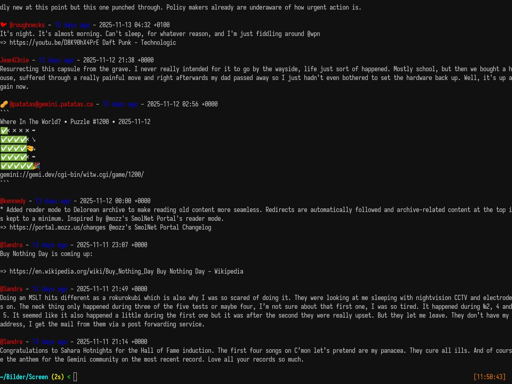

# Use gtl CLI



```
Usage:
	--config <configFile> - Indicate a specific config file.
	--mode {cli,tui,gemini}	- Select the cli or tui mode.
	--limit <num>	- When using cli mode, display only <num> items.
	--help - Display this help message.
```

Example:
```bash
gtl --mode cli --limit 10
gtl --limit 10 # cli mode is default, so this is the same as above.
gtl --mode cli --limit 10 --config path/to/config/file # with specific path for config file.
```

If you don't provide a config file path, gtl will look for it in `{homepath}/.config/gtl/gtl.toml`

You need a subscription file though with the list of tinylogs to follow:
```
<urlOfTinyLog> @nameOfTinyLog
<urlOfTinyLog2> @nameOfTinyLog2
…
```

Best is to use the official tinylog subscription list, which can now be found on my Gemini Capsule: [Recent Tinylog Subscription List](https://redterminal.org/tinylog-subscriptions.gmi). You can also directly download the [tinylog-subscriptions.txt](https://redterminal.org/tinylog-subscriptions.txt) file for direct use with GTL.

The subscribed tinylog list file is configured with this configuration option:
```toml
subscribed_data = "path/to/subscription/file"
```
