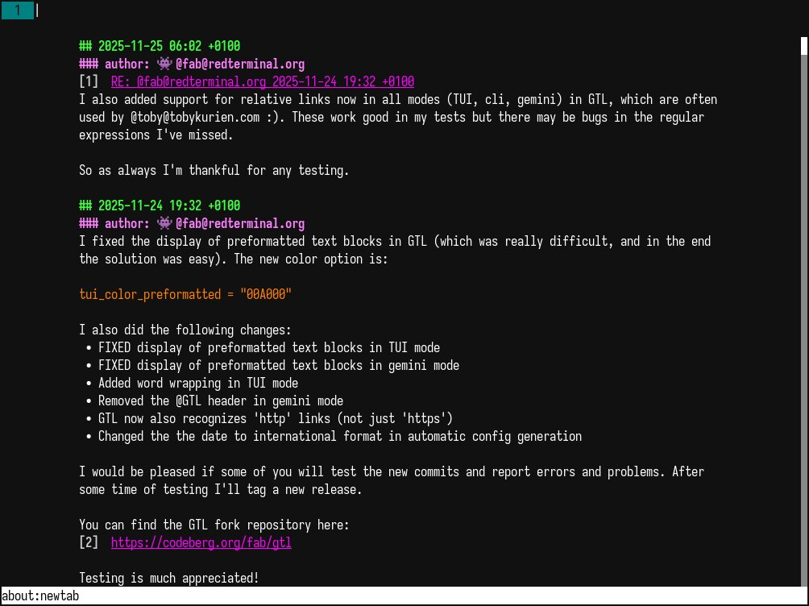

# Use gtl gemini mode

You can use gtl to generate a valid text/gemini output that could then be placed in a capsule (maybe in a CGI script) and read via a gemini browser:

```bash
~/bin/gtl --config ~/.config/gtl/test.gtl.toml --mode gemini --limit 55
```


